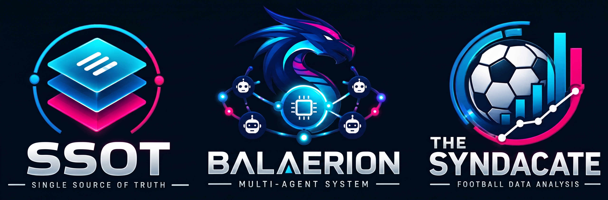

# Enterprise Knowledge Architecture (SSoT) & Systems Portfolio

**Architected & Compiled by:** Jef Aerts
**Methodology:** AI-Augmented Systems Architecture (Claude/LLM Orchestration)

## About the Architect
**Jef Aerts** is a systems architect and operational operator focused on structured knowledge governance, multi-provider AI gateway security, and deterministic data/accounting systems. This book presents three standalone architecture builds—**SSoT**, **Balaerion**, and **Syndicate**—emphasizing failure modes, design trade-offs, and verification over raw code dumps.

## Portfolio Overview

| System | Core Focus | Key Guardrail | Interactive Surface |
| :--- | :--- | :--- | :--- |
| **SSoT** | Multi-market knowledge architecture, relational schema (`T1`–`T10`), bot commands, and self-healing governance | Move-then-confirm publish, container inheritance, and 30-day archive kill switch | [SSoT Demo](https://aertsjef1989.github.io/Autonomous-SSoT-Architecture/demo/) |
| **Balaerion** | OmniRoute AI gateway + LibreChat, Hetzner/Oracle ARM failover, 23 MCP agents, and OSINT GTM layer | Cloudflare Access MFA, GDPR EU lane (Scaleway/Mistral EU), and evidence-only retrieval | [Balaerion Demo](https://aertsjef1989.github.io/Autonomous-SSoT-Architecture/balaerion/demo/) |
| **Syndicate** | Python Poisson/xG probability engine, read-only Next.js dashboard, group tipgame, and unit-share NAV ledger | Pre-kickoff slip lock, unit-share NAV pricing, and append-only ledger | [Syndicate Demo](https://aertsjef1989.github.io/Autonomous-SSoT-Architecture/syndicate/demo/) |

---

## SSoT Highlights

### The Constraint
Designed under strict enterprise compliance blockers that prohibited the use of standard off-the-shelf Knowledge Management Systems (e.g., Confluence, Zendesk KMS, Salesforce Knowledge).

### The Architecture
Engineered a custom, zero-license-cost knowledge operations system built entirely within the existing corporate tooling ecosystem. The architecture scales across 200 users and 45 markets, utilizing a custom relational schema and a two-layer conversational bot interface.

### The Business Case
Based on Eurostat labor data, the system targets an estimated **€1.89M to €2.81M** in annual productivity waste caused by information fragmentation and unstructured onboarding.

### The Engine (Autonomous Governance)
To prevent data decay without manual oversight, the system runs a 14-detector Self-Healing Loop. It enforces container-level permission inheritance via a strict 6-tier Access Matrix, and executes a 30-day autonomous archive "kill switch" on unverified data. This maintains structural integrity across 3,386 nodes while utilizing batched scanning to reduce automation budget consumption by 98%.

## Live Design System & Architecture Surfaces

- [Architecture Topology](ARCHITECTURE_FLOW.md)
- [Launch Interactive SSoT Architecture Demo](https://aertsjef1989.github.io/Autonomous-SSoT-Architecture/demo/)
- [Launch Signal Studio (Live Browser Editor)](https://aertsjef1989.github.io/Autonomous-SSoT-Architecture/signal/02_studio/signal-studio.html)
- [Browse Signal Device & Template Gallery](https://aertsjef1989.github.io/Autonomous-SSoT-Architecture/signal/02_studio/signal-gallery.html)
- [Signal Design System Specification](11-Signal-Design-System.md)

---

### Balaerion Core Agent Topology (Selected Personas)

| Agent Persona | Primary Responsibility | Guardrail / Output Contract |
| :--- | :--- | :--- |
| **Scout** | Parallel firmographic, technographic, and OSINT signal research | Structured JSON account brief; zero unverified claims |
| **Campaign Architect** | Maps account signals against the RAG Knowledge Base for custom plays | Territory- and vertical-scoped campaign blueprint |
| **Voice & Outreach Engine** | Generates email/call drafts using per-rep **Voice Profiles** and regional RAG context | Staged draft only; LinkedIn automation and auto-send hard-blocked |
| **Relay Agent** | Packages qualification state, objections, and context for SDR → AE → CS handovers & incubation | Deterministic handover brief triggered on state transition |
| **Quant** | Monitors 7-state velocity, surfaces deal risk, and diagnoses campaign bottlenecks | Read-only telemetry & bottleneck alerts; no blind CRM mutations |
| **Compliance Overlord** | Enforces regional regulations (GDPR Art. 15/17/35), channel bans, and schema validation | Hard circuit breaker (`#F0245C`) blocking non-compliant payloads |

## Interactive Standalone Prototypes
* <a href="demo/index.html" target="_blank">Open Interactive SSoT Demo</a>
* <a href="balaerion/demo/index.html" target="_blank">Open Interactive Balaerion Prototype</a>
* <a href="syndicate/demo/index.html" target="_blank">Open Interactive Syndicate Prototype</a>
